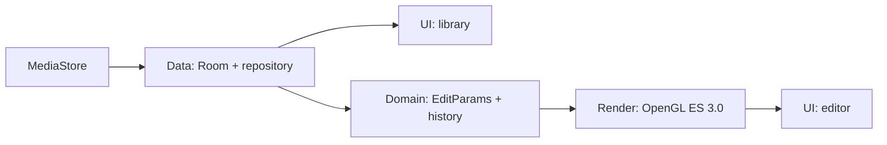

# OpenRoom

OpenRoom is a local-only, non-destructive photo editor for Android 8+. The project uses Kotlin, Jetpack Compose, Room, Paging-ready catalog boundaries, Coil, Hilt, coroutines, and an OpenGL ES 3.0 rendering path.

## Build

Install Android Studio or the Android SDK and run:

```sh
./gradlew assembleDebug
./gradlew test
```

## Architecture



The current first milestone imports the device image catalog, displays a thumbnail grid, provides the immutable edit model and undo/redo stack, and includes the single-pass exposure shader foundation. Pixel copies are never persisted; edit parameters are serialized for Room.

## Roadmap

1. Complete the interactive editor canvas and all shader controls.
2. Add proxy texture sizing, before/after comparison, ratings, flags, and Paging 3.
3. Add tiled full-resolution export with EXIF preservation.
4. Add golden shader tests and performance profiling on mid-range devices.

RAW support is intentionally out of scope for the initial milestones.
